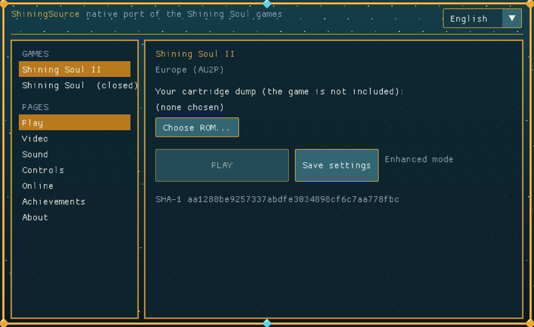
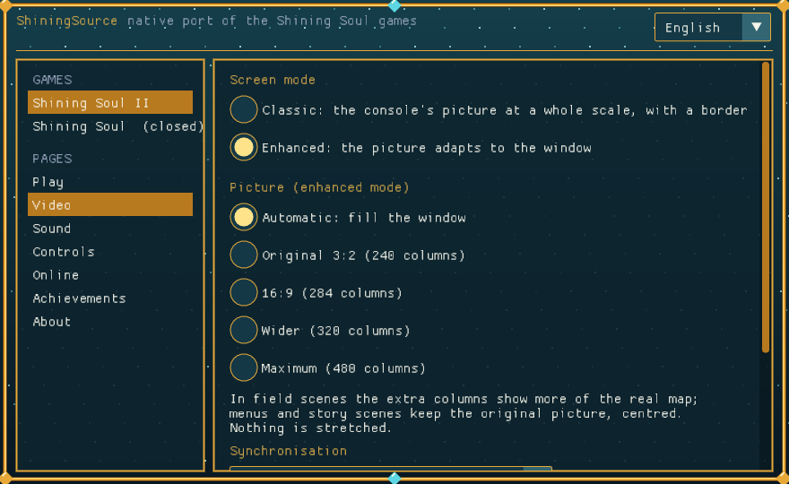
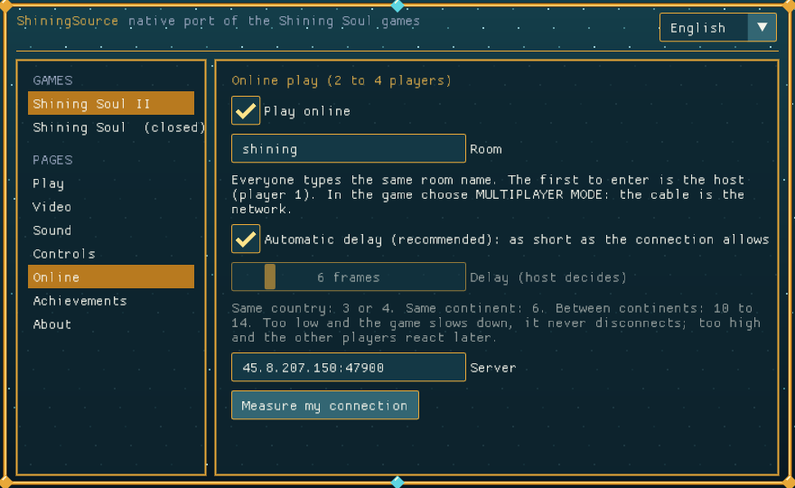
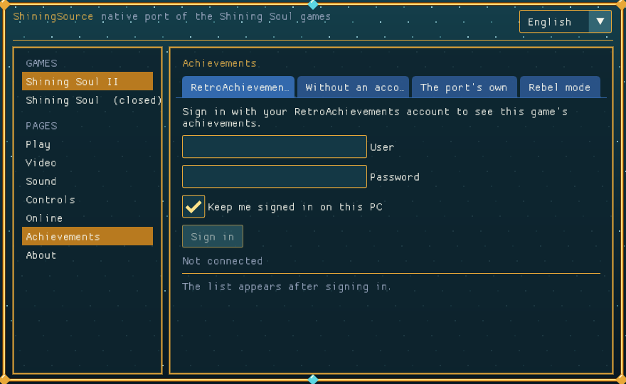

# ShiningSource

A native port of the Game Boy Advance *Shining Soul* games, built from their
matching decompilations: the original game logic compiled for today's machines,
not emulated and not statically recompiled.

| Game | Source | Status |
|---|---|---|
| **Shining Soul II** (Europe, `AU2P`) | [SS2Decomp](https://github.com/MatyMeatBoy/SS2Decomp): 100% matching C | **Playable**, in active development |
| **Shining Soul** | [SS1Decomp](https://github.com/MatyMeatBoy/SS1Decomp): decompilation in progress | Joins the port when its decomp is ready ([games/ss1](games/ss1/README.md)) |

**No ROM, BIOS or game data is included, here or in the releases.** You supply
your own cartridge dump (Shining Soul II Europe, SHA-1
`aa1288be9257337abdfe3034898cf6c7aa778fbc`); graphics, text and music are read
from it when you play.



*The launcher, drawn in the port's own "Soul" look. No screenshots of the game
are stored in this repository: they are the game's artwork.*

## Download

[Releases](https://github.com/MatyMeatBoy/ShiningSource/releases): Windows x64
(`.zip`, unpack and start `ShiningSource.exe`) and Android (`.apk`, arm64-v8a
and x86_64, Android 5 or later). They are pre-releases: each one's notes list
what was checked and, just as carefully, what was not.

## What it does

### The game
- Every function of the cartridge is the decompilation's C, compiled unchanged.
  The port is the layer underneath: memory, the task scheduler, interrupts,
  video, sound, saves, input and the link cable.
- **64-bit** hosts on Windows, Linux (x64 and ARM64) and Android run the game's
  32-bit code inside one process. The same scripted 32,000-frame play-through
  ends in the same frame hash on the builds that are tested with it.
- Saving works as on the cartridge, with a backup of the previous save kept
  beside it.

### Picture
- **Two screen modes.** *Classic*: the console's picture at a whole scale
  inside an adjustable border. *Enhanced*: the picture takes the width of your
  window at a whole scale, always pixel-exact.
- **Real widescreen.** In the field the extra columns show more of the map the
  game already has (up to twice the console's width), not a stretched picture.
  Characters, enemies and objects stay visible beside the console's columns.
- **The status display follows the screen**: HP, SP and Soul sit at the left
  edge, the L and R menus at the left and right edges; full-screen pages and
  menus keep their composition in the middle and are always drawn whole.
- **Real transparency.** The cartridge fakes transparency by showing a sprite
  every other frame (shadows, ghosts, markers, a character that was just hurt),
  which a modern display shows as hard blinking. Those sprites are drawn at
  half strength in every frame instead; fast blinking drawn any other way is
  smoothed the same way.
- Where a map ends beside the view, the picture fades into black; around a
  dark screen (a fade, a loading screen) the sides darken with it.
- VSync, variable refresh (G-Sync / FreeSync) or neither.



### Online, 2 to 4 players
- The game's own MULTIPLAYER MODE over the internet, through a small relay
  (`relay/`, one UDP port; a public one is the default). Same room name for
  everybody, then MULTIPLAYER MODE in the game.
- Built around what the game's link code really does (see
  [GBANoCable, chapter 8](https://github.com/MatyMeatBoy/GBANoCable/blob/main/docs/08-decomp-to-native-port.md)):
  each player's state is handed over the moment it arrives, nobody waits for a
  slow player, and the game's one-time events (an enemy appears, an item is
  dropped or taken, a change of map) travel whole on a reliable channel instead
  of step by step. A message measured 16 ms between players on one machine.
- A player who leaves, crashes or loses the connection stays as a standing
  character and the others play on. (When player 1 leaves, the session ends:
  the game gives player 1 the enemies and the items.)
- Crossplay between Windows, Linux and Android.



### Comfort
- **Skip scene.** Start during the introduction or a story sequence offers to
  skip it; it stops at any question instead of answering for you. Online it is
  a vote of all players, and the game's own exits are used so nothing runs
  fast.
- **Launcher**: verifies your ROM (and finds one that sits beside it), screen
  mode, sound, every key and controller button reassignable, online, language
  (English / Spanish). It closes when the game starts.
- **Touch controls** on Android.
- **Reports**: a crash or a hang on Windows writes `shiningsource_crash.log`,
  and an online session writes `shiningsource_net.log`, beside the program.

### Achievements
- The RetroAchievements set of your ROM is followed while you play, with a
  notice and the achievement's badge when one unlocks. Sending unlocks to your
  account is **off by default**: this port is not a client RetroAchievements
  has approved, and an unlock cannot be taken back.
- Without an account: the port's own twelve achievements, and the downloaded
  set, are kept in a local record.
- **Rebel mode**: cheats (full HP, full SP, no defeat, gold), with their own
  record and their own save file. Nothing of a Rebel run reaches
  RetroAchievements, and cheats stop while the link is running.



## Platforms

| Platform | State |
|---|---|
| Windows x64 | Released; the main test platform |
| Android (arm64-v8a, x86_64) | Released; tested in the x86_64 emulator (0.7.3), not yet on a phone |
| Linux x64, ARM64 | Builds and passes the reference run and an online session in virtual machines (Debian 12, 0.7.2); no packaged release, not tried on a desktop |
| Browser (WebAssembly) | Builds from source and plays from your ROM file, saves kept in the browser; offline only; no hosted page |
| PS5, PS4, Switch, Vita | Not started |

## Honest state

This is a port in development, tested mostly by scripted runs on one machine
and by a small group of players. Known and open at the time of writing:

- Online has been played by three and four people, and each release answers
  what they found; several of those fixes come from reading the game's code and
  have not been confirmed in a real session yet. The release notes say which.
- Some areas have no music yet (the port has its own implementation of the
  cartridge's sound engine, and it does not cover everything).
- Joining a game that is already in progress is not possible.

The order of work is in [docs/ROADMAP.md](docs/ROADMAP.md); the design and its
reasons in [docs/ARCHITECTURE.md](docs/ARCHITECTURE.md); measurements of
memory, frame pacing and crash handling in [docs/OPTIPORT.md](docs/OPTIPORT.md).

## Controls

Keyboard: arrows, `X` = A, `Z` = B, `C` = L, `V` = R, `Enter` = Start, right
`Shift` = Select, `F11` full screen. A controller works when plugged in. All of
it can be changed in the launcher.

## Building (developers)

Requirements: Python 3, git, [llvm-mingw](https://github.com/mstorsjo/llvm-mingw)
(`SHININGSOURCE_LLVM_MINGW`) and SDL3 development files (`SHININGSOURCE_SDL3`).

```sh
git clone --recurse-submodules https://github.com/MatyMeatBoy/ShiningSource
cd ShiningSource
python3 tools/build.py prepare      # the game's C, with the port's patches (games/ss2/port/patches.json)
python3 tools/build.py compile
python3 tools/link.py               # 32-bit development program: build/dev32/ss2/ss2_dev32.exe
python3 tools/build_win64.py        # 64-bit host + game image: build/win64/ss2/
python3 tools/build_launcher.py     # the launcher: ShiningSource.exe
```

Other targets: `tools/build_linux64.py`, `tools/build_arm64.py`,
`tools/build_android.py`, `tools/build_web.py`. After changing
`games/ss2/port/patches.json` run `prepare` and `compile` again before linking.

The port is tested without a window: `SS_FRAMES=N SS_INPUT_FILE=script
ss2_dev32.exe rom.gba` plays a scripted run and prints a hash of the video
state per frame; `tools/net_test.sh` runs several players through a local
relay. The decompilation itself is never edited from this repository: what the
port needs changed in the game's C is a list of small patches, each with its
reason.

## Layout

| Path | Content |
|---|---|
| `games/ss2/decomp` | submodule: the Shining Soul II decompilation |
| `games/ss2/port` | what this game needs to build natively: modules the runtime replaces, source patches with their reasons |
| `runtime/` | the port: core (video, sound, saves, scheduler, link), hosts, platform code, achievements |
| `launcher/` | the Windows launcher |
| `android/` | the Android package |
| `relay/` | the online relay |
| `tools/` | build drivers, generators and tests |
| `docs/` | architecture, roadmap, release notes |

## Credits and license

Built on the Shining Soul II decompilation and its contributors, including
[emmkay440](https://github.com/emmkay440), author of the original Shining Soul
decompilation. Sister projects: [ReKHCoM](https://github.com/MatyMeatBoy/ReKHCoM)
and [GBANoCable](https://github.com/MatyMeatBoy/GBANoCable).

The port's code is MIT ([LICENSE](LICENSE)); SDL3, Dear ImGui and rcheevos keep
their own licenses. The games belong to their owners. This project distributes
none of their data: without your own cartridge dump it does nothing.
