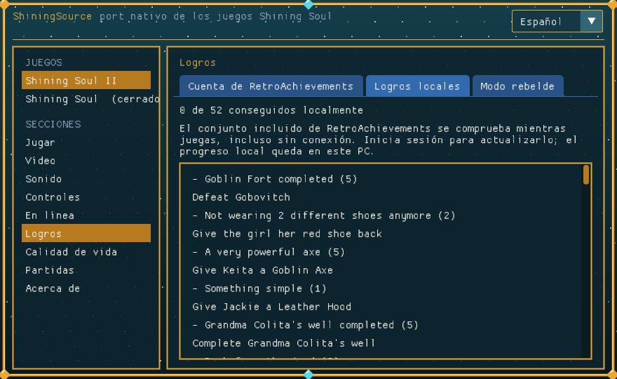
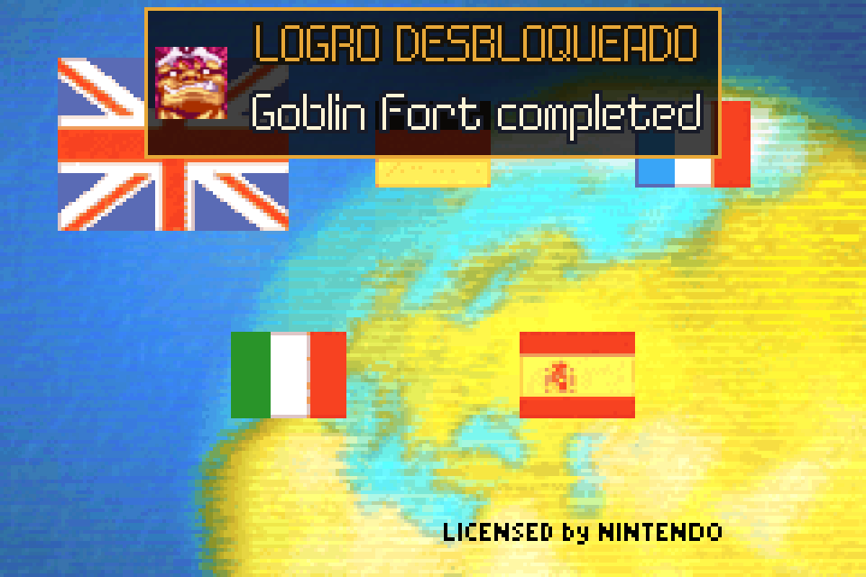

# Windows achievements verification — 0.8.12

Verified on 2026-11-17 with the supported European Shining Soul II ROM.

| Check | Result |
| --- | --- |
| Official game / ROM hash | 7095 / `49aa688745111aaa51076a345f8f18c3` |
| Published achievements / points | 52 / 454 |
| Definitions activated and addresses validated | 52; none disabled |
| Alternate RA condition groups replayed | 252 / 252 |
| Official badge images decoded | 52 / 52 |
| Blank RAM false unlocks | 0 |
| Python regression suite | 52 tests passed |
| Windows game image, host and launcher | rebuilt successfully |
| Native smoke test | 80,000 frames, clean exit, no local/Rebel false unlocks |
| Launcher local tab | rendered and visually inspected in Spanish; 0/52, official titles and descriptions |
| Popup | rendered and visually inspected with the matching Goblin badge and title |

The replay uses the exact downloaded RA definitions with synthetic before/after RAM snapshots. It exercises the production host's memory mapping, rcheevos runtime, record writing and badge loading. It is not a complete gameplay playthrough. Eleven of the original alternate groups trigger during the setup snapshot; those RA conditions are left unchanged. The popup screenshot uses the existing test-notice hook and is not evidence of a boss defeated during that screenshot.

The regression harness additionally checks late catalog loading without a signed-in client, original ROM hash retention after byte patching, exclusion of unofficial/warning/custom achievements, persistence without duplicate records, independent Rebel progress, account notification after an earlier local unlock, and multiple queued account notices.

No synthetic unlock was sent to an account. The RA server returned an unknown-client warning, so hardcore support is not approved. An actual earned account award and all 52 achievements reached through normal gameplay remain unverified.

## Reproduce

Build the launcher first to compile the bundled rcheevos objects, then:

```powershell
python tools/build_launcher.py
python -m unittest discover -s tools/tests -p "test_*.py"
python tools/tests/verify_ra_catalog.py assets/achievements/ra_set_49aa688745111aaa51076a345f8f18c3.json C:/path/to/your.gba C:/path/to/verification-output
python tools/package_windows.py 0.8.12
```

The catalog and artwork source is documented in [assets/achievements/SOURCE.md](../assets/achievements/SOURCE.md).





# Handheld achievements (GA36, R36S, Linux x64)

The Linux hosts evaluate the same set with the same code as Windows (`runtime/achievements/ach_host.c`, now portable)
and talk to RetroAchievements themselves over HTTPS (`launcher/achievements/ra_https_posix.inc`: raw sockets and
OpenSSL opened at run time, certificate and host name always verified, only the retroachievements.org hosts). The design
follows ReKHCoM's GA36 port:

- The card is linked once from a PC (GA36: `Vincular-RetroAchievements-ShiningSource.bat` runs `platform/ga36/ra_vincular_cuenta.py`, r=login2, or copies ReKHCoM's session): the port folder then holds
  `retroachievements.auth` (128-byte name + 128-byte token) and `retroachievements.ini` (`enabled=1`). Without them the
  game uses ReKHCoM's sign-in on the same card (`../rekhcomga36/retroachievements.auth`, `SS_RA_SHARED_AUTH`), read but
  never copied. No sign-in is copied outside the card.
- Unlocks of the local evaluation are queued for the card's account in `retroachievements_pending.txt` and sent at the
  next start with a connection, after the account's own list is read (already unlocked ones are dropped). An unlock or
  a start without a believable clock (before 2025, as on a GA36 without a clock battery) is sent as just earned.
- `retroachievements_estado.txt` holds the account's name, the connection state, how many unlocks wait, the progress
  on the console and the console's clock. Never the token.
- Softcore only. A Rebel run (cheats) creates no client: no request, nothing queued. `SS_RA_SUBMIT=0` keeps everything
  on the console (the start scripts set 1).
- The GA36 package carries `libssl.so.3`/`libcrypto.so.3` and a CA bundle (`achievements/cacert.pem`, certifi's
  Mozilla list, MPL-2.0); the R36S uses the firmware's OpenSSL (`libssl.so.3` or `libssl.so.1.1`).

Rebased images (the ARM handhelds) keep the GBA memory in a block of their own: the host asks the image for its address
(`SS_OPTION_GBA_ADDRESS`) on the first frame, then hashes the ROM file and starts the evaluation.

## Verified on 2026-11-26

| Check | Result |
| --- | --- |
| Windows 0.9.5 game, pretend site (`SS_RA_TEST_SERVER`, `SS_RA_TEST_LOGIN`), `tools/tests/play_input.txt` | test achievement unlocked at about frame 3100: local record, account notice, `awardachievement 900001` |
| Windows Rebel run (`SS_CHEATS=hp`) | Rebel record only, no request at all |
| `tools/tests/test_achievements.py`, `test_ra_pending.py` | pass (queue, believable ages, softcore, warning id never queued) |
| GA36 package in QEMU (`tools/ga36_vm_test.py ra`) | shipped set 52/52 evaluated; ReKHCoM's sign-in used; real HTTPS path offline without a network; mode notice drawn on the fbdev Flat canvas; offline unlock recorded and queued; online run sends it; Rebel run sends nothing |
| GA36 memory view | EWRAM bytes read by the host equal the Windows build's at the same frames (`SS_RA_TEST_PEEK`) |

The test achievement (`tools/ra_fixture.py`) reads EWRAM 0x02034E3C. IWRAM 0x0300003C differs between builds (0xE0 on
Windows, 0x25 on the GA36); the official set only compares that byte with itself.

Not verified: a real connection from a console (the VM has no network card; the real server was never contacted with
an account), the R36S and Linux x64 builds beyond compiling and packaging, and the first-frame pause for hashing the
16 MiB ROM on the real GA36.

```powershell
py -3.12 tools/ga36_vm_test.py ra build/ga36/ShiningSource-GA36-<version>.zip --rom ROM --input tools/tests/play_input.txt --out DIR
```
